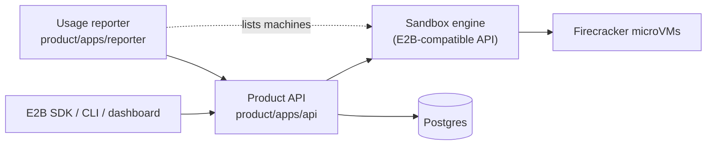

# Rookbox

[](https://github.com/corvo-technology/rookbox/actions/workflows/product-ci.yml)

**Português:** veja [README.md](README.md).

Rookbox gives AI agents full Linux computers on demand. Each machine is an isolated Firecracker
microVM: it starts in about 2 seconds, can be suspended and restored with its memory intact, and
speaks the E2B SDK protocol. If your agent already uses the SDK, you only change two environment
variables.

- Site: <https://rookbox.run>
- Docs: <https://docs.rookbox.run>
- Dashboard: <https://app.rookbox.run>

## What you get

- **Machines in ~2 s.** Fast creation from templates (`desktop`, `seed`, ...).
- **Suspend and resume.** An idle machine suspends and comes back where it left off.
- **E2B SDK compatible.** `Sandbox.create()`, commands, files and ports, nothing reimplemented.
- **Desktop.** A full desktop in the browser for agents that drive a GUI.
- **CLI.** `rookbox new`, `rookbox shell` and the rest from your terminal.
- **Dashboard.** Machines, API keys and usage.

## 60-second quickstart

Create an API key in the dashboard and export two variables:

```sh
export E2B_API_KEY=rbx_...
export E2B_API_URL=https://api.rookbox.run
```

Python (`pip install e2b`):

```python
from e2b import Sandbox

sbx = Sandbox.create()
print(sbx.commands.run("uname -a").stdout)
sbx.kill()
```

TypeScript (`npm install e2b`):

```ts
import { Sandbox } from "e2b";

const sbx = await Sandbox.create();
console.log((await sbx.commands.run("uname -a")).stdout);
await sbx.kill();
```

Or from the command line (macOS and Linux):

```sh
curl -fsSL https://rookbox.run/install | sh
rookbox login        # asks for the API key, checks it, saves it
rookbox new          # creates a machine and prints its id
rookbox shell <id>   # a terminal inside it
```

## Architecture



The product API handles accounts, keys, limits and usage, and forwards machine operations to the
sandbox engine. The reporter runs next to the engine and ships usage events to the API.

## Repository map

**Product** (`product/`, a pnpm + Turborepo workspace):

| Path | What it is |
| --- | --- |
| `product/apps/api` | Product API: Hono, oRPC, Prisma + Postgres, better-auth. |
| `product/apps/web` | Dashboard: Vite, React. Machines, keys and usage. |
| `product/apps/www` | Landing site (Astro) in Portuguese, English and Spanish, with a waitlist. |
| `product/apps/docs` | Docs site (Astro Starlight), Portuguese and English. |
| `product/apps/reporter` | Usage metering, runs next to the engine. |
| `product/apps/cli` | The `rookbox` command line tool. |
| `product/packages/contracts` | The oRPC contract and the machine lifecycle rules. |
| `product/packages/ui-tokens`, `ui-web` | Design tokens and UI components. |

**Sandbox engine** (Rust, Firecracker microVMs, at the repository root):

| Path | What it is |
| --- | --- |
| `crates/` | The engine's Rust services and libraries |
| `proto/` | gRPC definitions |
| `db/` | Schemas and migrations |
| `shim/` | Go shim |
| `templates/` | Machine templates |
| `docker/` | Images and build contexts |
| `infra/` | Deployment and infrastructure |
| `scripts/`, `ci/` | Build and test scripts and tooling |
| `ui/` | The engine's admin interface |
| `docs/` | Engine documentation (start with `docs/architecture.md`) |
| `space_smoke/` | Smoke tests (Python) |
| `fuzz/`, `supply-chain/`, `examples/` | Fuzzing, dependency audit and examples |

## Local development

Needs Node 22.12+ and pnpm 9 (`corepack enable`).

```sh
cd product
pnpm install
pnpm dev                          # site and dashboard together
pnpm --filter @rookbox/www dev    # http://127.0.0.1:4321
pnpm --filter @rookbox/web dev    # http://127.0.0.1:5173
pnpm --filter @rookbox/docs dev   # docs site
```

**Demo mode:** without `VITE_API_URL` the dashboard runs on an in-memory fake API, with no login
and no backend. To use the real API (needs Postgres and an engine), copy
`product/apps/api/.env.example` to `.env` and run:

```sh
pnpm --filter @rookbox/api dev
VITE_API_URL=http://127.0.0.1:3000 pnpm --filter @rookbox/web dev
```

Checks (the same as CI):

```sh
cd product
pnpm lint check test build    # pnpm format fixes style
```

To build and test the engine, read `docs/development-overview.md`.

## Deploy

Each service is a Docker image built from `product/` (`apps/<app>/Dockerfile`). Steps,
environment variables and DNS are in [`product/DEPLOY.md`](product/DEPLOY.md).

| Service | Where it runs |
| --- | --- |
| API and Postgres | Guará Cloud |
| Dashboard, landing and docs | A VPS (Caddy) |
| Reporter | Next to the sandbox engine |

## Repository conventions

- Pull requests branch off `main`; see [CONTRIBUTING.md](CONTRIBUTING.md).
- The `Product CI` workflow runs lint, check, test and build for `product/` on every PR.
- Secret scanning with gitleaks (`pre-commit install`). Never commit `.env`.

## Beta

Rookbox is in closed beta. Join the waitlist at <https://rookbox.run>; invites go out by email.

## Security

Report vulnerabilities privately; see [SECURITY.md](SECURITY.md).

## License

Rookbox's own code is proprietary, all rights reserved (TODO(owner): confirm the license). The
Apache-2.0 [LICENSE](LICENSE) file at the root is kept because the sandbox engine and the Git
history contain code under that license.
