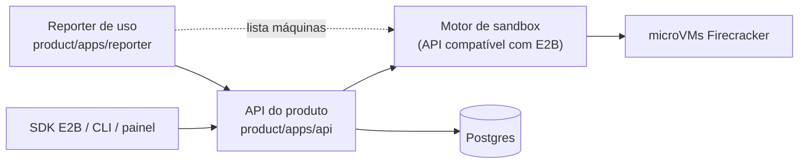

# Rookbox

[](https://github.com/corvo-technology/rookbox/actions/workflows/product-ci.yml)

**English:** see [README.en.md](README.en.md).

Rookbox entrega computadores Linux completos, sob demanda, para agentes de IA. Cada máquina é uma
microVM Firecracker isolada: nasce em cerca de 2 segundos, pode ser suspensa e restaurada com a
memória intacta, e fala o protocolo do SDK da E2B. Se o seu agente já usa o SDK, basta trocar duas
variáveis de ambiente.

- Site: <https://rookbox.run>
- Documentação: <https://docs.rookbox.run>
- Painel: <https://app.rookbox.run>

## O que você ganha

- **Máquinas em ~2 s.** Criação rápida a partir de templates (`desktop`, `seed`, ...).
- **Suspender e retomar.** A máquina ociosa é suspensa e volta de onde parou.
- **Compatível com o SDK da E2B.** `Sandbox.create()`, comandos, arquivos e portas, sem reimplementar nada.
- **Desktop.** Uma área de trabalho completa no navegador, para agentes que usam a interface gráfica.
- **CLI.** `rookbox new`, `rookbox shell`, e o resto no terminal.
- **Painel.** Máquinas, chaves de API e uso.

## Comece em 60 segundos

Crie uma chave de API no painel e exporte duas variáveis:

```sh
export E2B_API_KEY=rbx_...
export E2B_API_URL=https://api.rookbox.run
```

Python (`pip install e2b`):

```python
from e2b import Sandbox

sbx = Sandbox.create()
print(sbx.commands.run("uname -a").stdout)
sbx.kill()
```

TypeScript (`npm install e2b`):

```ts
import { Sandbox } from "e2b";

const sbx = await Sandbox.create();
console.log((await sbx.commands.run("uname -a")).stdout);
await sbx.kill();
```

Ou pela linha de comando (macOS e Linux):

```sh
curl -fsSL https://rookbox.run/install | sh
rookbox login        # pede a chave de API, valida e salva
rookbox new          # cria uma máquina e imprime o id
rookbox shell <id>   # terminal dentro dela
```

## Arquitetura



A API do produto cuida de contas, chaves, limites e uso, e repassa as operações de máquina ao
motor de sandbox. O reporter roda ao lado do motor e envia eventos de uso à API.

## Mapa do repositório

**Produto** (`product/`, workspace pnpm + Turborepo):

| Caminho | O que é |
| --- | --- |
| `product/apps/api` | API do produto: Hono, oRPC, Prisma + Postgres, better-auth. |
| `product/apps/web` | Painel: Vite, React. Máquinas, chaves e uso. |
| `product/apps/www` | Site (Astro) em pt-BR, inglês e espanhol, com lista de espera. |
| `product/apps/docs` | Site de documentação (Astro Starlight), pt-BR e inglês. |
| `product/apps/reporter` | Medição de uso, roda ao lado do motor. |
| `product/apps/cli` | Linha de comando `rookbox`. |
| `product/packages/contracts` | Contrato oRPC e regras do ciclo de vida das máquinas. |
| `product/packages/ui-tokens`, `ui-web` | Tokens de design e componentes de interface. |

**Motor de sandbox** (Rust, microVMs Firecracker, na raiz):

| Caminho | O que é |
| --- | --- |
| `crates/` | Serviços e bibliotecas Rust do motor |
| `proto/` | Definições gRPC |
| `db/` | Esquemas e migrações |
| `shim/` | Shim em Go |
| `templates/` | Templates de máquina |
| `docker/` | Imagens e contextos de build |
| `infra/` | Implantação e infraestrutura |
| `scripts/`, `ci/` | Scripts e ferramentas de build e teste |
| `ui/` | Interface administrativa do motor |
| `docs/` | Documentação do motor (comece por `docs/architecture.md`) |
| `space_smoke/` | Testes de fumaça (Python) |
| `fuzz/`, `supply-chain/`, `examples/` | Fuzzing, auditoria de dependências e exemplos |

## Desenvolvimento local

Requer Node 22.12+ e pnpm 9 (`corepack enable`).

```sh
cd product
pnpm install
pnpm dev                          # site e painel juntos
pnpm --filter @rookbox/www dev    # http://127.0.0.1:4321
pnpm --filter @rookbox/web dev    # http://127.0.0.1:5173
pnpm --filter @rookbox/docs dev   # site de documentação
```

**Modo demo:** sem `VITE_API_URL`, o painel roda sobre uma API falsa em memória, sem login e sem
backend. Para usar a API real (precisa de Postgres e de um motor), copie
`product/apps/api/.env.example` para `.env` e rode:

```sh
pnpm --filter @rookbox/api dev
VITE_API_URL=http://127.0.0.1:3000 pnpm --filter @rookbox/web dev
```

Verificações (as mesmas do CI):

```sh
cd product
pnpm lint check test build    # pnpm format corrige o estilo
```

Para compilar e testar o motor, leia `docs/development-overview.md`.

## Deploy

Cada serviço é uma imagem Docker de `product/` (`apps/<app>/Dockerfile`). Passo a passo,
variáveis de ambiente e DNS em [`product/DEPLOY.md`](product/DEPLOY.md).

| Serviço | Onde roda |
| --- | --- |
| API e Postgres | Guará Cloud |
| Painel, site e documentação | VPS (Caddy) |
| Reporter | Ao lado do motor de sandbox |

## Convenções do repositório

- Pull requests a partir de `main`; veja [CONTRIBUTING.md](CONTRIBUTING.md).
- O workflow `Product CI` roda lint, check, test e build de `product/` em cada PR.
- Varredura de segredos com gitleaks (`pre-commit install`). Nunca commite `.env`.

## Beta

A Rookbox está em beta fechado. Entre na lista de espera em <https://rookbox.run>; os convites
saem por e-mail.

## Segurança

Reporte vulnerabilidades em particular; veja [SECURITY.md](SECURITY.md).

## Licença

O código próprio da Rookbox é proprietário, todos os direitos reservados
(TODO(owner): confirmar a licença). O arquivo [LICENSE](LICENSE) (Apache-2.0) na raiz é mantido
porque o motor de sandbox e o histórico do Git contêm código sob essa licença.
